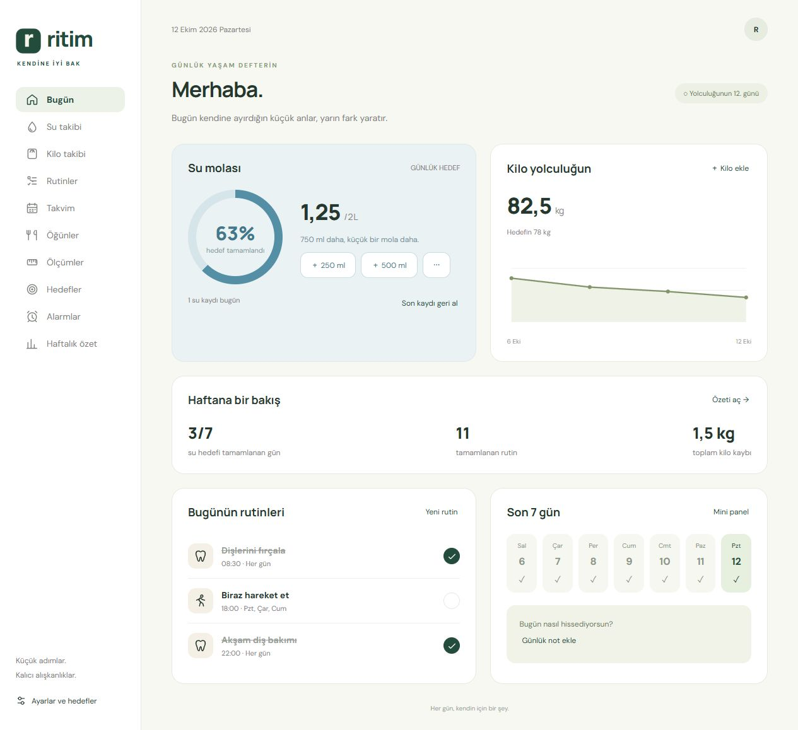
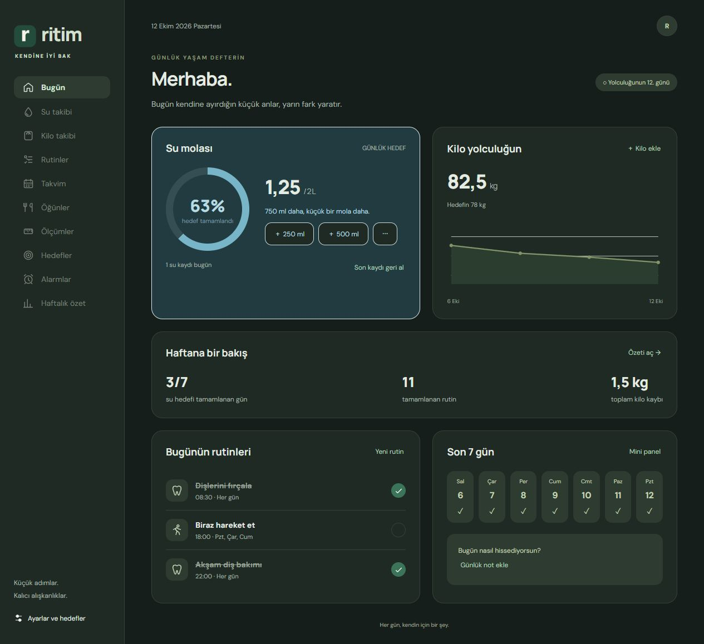

<p align="center"></p>

# Ritim

**Windows için su, kilo, alışkanlık ve hedef takibi.** Yerel çalışır; günlük kayıtlar bilgisayarında kalır. Hesap veya internet bağlantısı gerekmez.

[**Windows kurulumunu indir**](https://github.com/iflaholmaz/ritim/releases/latest) · [Sürümler](https://github.com/iflaholmaz/ritim/releases) · [Hata bildir](https://github.com/iflaholmaz/ritim/issues)

## Kurulum

1. Son sürümdeki `Ritim-Kurulum.exe` dosyasını indir.
2. Açıp **Kur ve aç** düğmesine bas.
3. Masaüstündeki **Ritim** kısayoluyla kullanmaya başla.

Kurulum kullanıcı hesabının uygulama klasörüne yapılır. Güncellemeler takip kayıtlarını korur. Pencerenin kapatma düğmesi Ritim’i sistem tepsisine küçültür; tamamen çıkmak için tepsi menüsünü kullan.

## Neler yapabilirsin?

| Bölüm | Özellikler |
|---|---|
| Su | Tek dokunuşla su ekleme, günlük hedef ve ayarlanabilir bildirim aralığı |
| Kilo | Kayıt geçmişi, grafik, toplam değişim, hedef tarihi ve ara hedefler |
| Rutinler | Seçili günler, hafta içi/sonu, saatli hatırlatmalar ve diş fırçalama sayacı |
| Hedefler | Elle ilerleme veya su/rutin kayıtlarından otomatik takip |
| Alarmlar | Dakika aralığı, günlük saat, çalışma saatleri ve açılıp kapanabilen ses |
| Hızlı bildirim | Uygulamayı açmadan **250 ml içtim**, **Tamamlandı**, **10 dakika ertele** |
| Mini panel | Her zaman üstte küçük pencere, su miktarı ve sıradaki hatırlatma |
| Haftalık özet | Su hedefi tamamlanan günler, rutinler ve kayıtlar arasındaki kilo değişimi |
| Günlük defter | Öğün kaydı, bel ölçüsü, takvim ve günlük notlar |
| Görünüm | Açık/koyu/sistem teması, üç yazı boyutu ve ana ekran kart sırası |
| Veriler | 30 günlük otomatik yedek, JSON dışa/içe aktarma, silinen kayıtları geri alma |

Hatırlatmalar Ritim sistem tepsisinde çalışırken gönderilir. Bilgisayar kapalı veya uykudayken bildirim gönderilmez. Geri sayımın bitiş zamanı saklanır; uygulama tekrar açıldığında süre geçtiyse bir kez bildirilir. Windows bildirim ayarları ve ses seviyesi bildirimleri etkileyebilir. Hızlı işlemler Ritim’in kendi küçük bildirim penceresinde sunulur.

## Görünüm



<details><summary>Koyu temayı göster</summary></details>

Ekran görüntülerindeki kayıtlar tanıtım için oluşturulmuş örnek verilerdir.

## Yerel kayıt

Veri klasörü: `%APPDATA%\Ritim`

- `kayitlar.json`: takip kayıtları ve tercihler
- `kayitlar.json.bak`: bir önceki kayıt
- `alarmlar.json`: sayaç, erteleme ve alarm zamanlaması
- `yedekler/`: son 30 günün yerel yedekleri

Kullanıcı kayıtları bu depoda ve kurulum paketinde bulunmaz. Silinen kayıtlar 30 gün geri alınabilir. Kaldırma işlemi takip kayıtlarını silmez.

## Geliştirme ve derleme

Windows 10/11 x64, Node.js ve Windows’un .NET Framework C# derleyicisi gerekir.

```powershell
npm install
npm start
npm test
npm run build
```

`npm run build`, resmî Electron 44.7.0 Windows çalışma ortamını indirir, SHA-256 kontrolünü yapar, Ritim simgesini EXE’ye işler ve `dist/Ritim-Kurulum.exe` dosyasını üretir. Kurulum paketi imzasızdır. Üçüncü taraf çalışma ortamı lisansları pakette korunur.

Kaynaklar `src/`, Windows kurulum araçları `scripts/`, çekirdek zamanlama testleri `tests/` içindedir. Grafik arayüz ve yerel kayıt köprüsü Electron’un izole preload katmanıyla ayrılmıştır.

## Kullanılan bileşenler

- [Electron](https://www.electronjs.org/): Windows uygulama çalışma ortamı.
- [DM Sans ve Manrope](https://fonts.google.com/): yerel paketlenmiş yazı tipleri; OFL lisansları `src/ui/` altında.
- Banner: Imagegen ile hazırlanmış tanıtım görseli.

Bu uygulama kişisel takip içindir; diyet planı veya tıbbi öneri üretmez.

